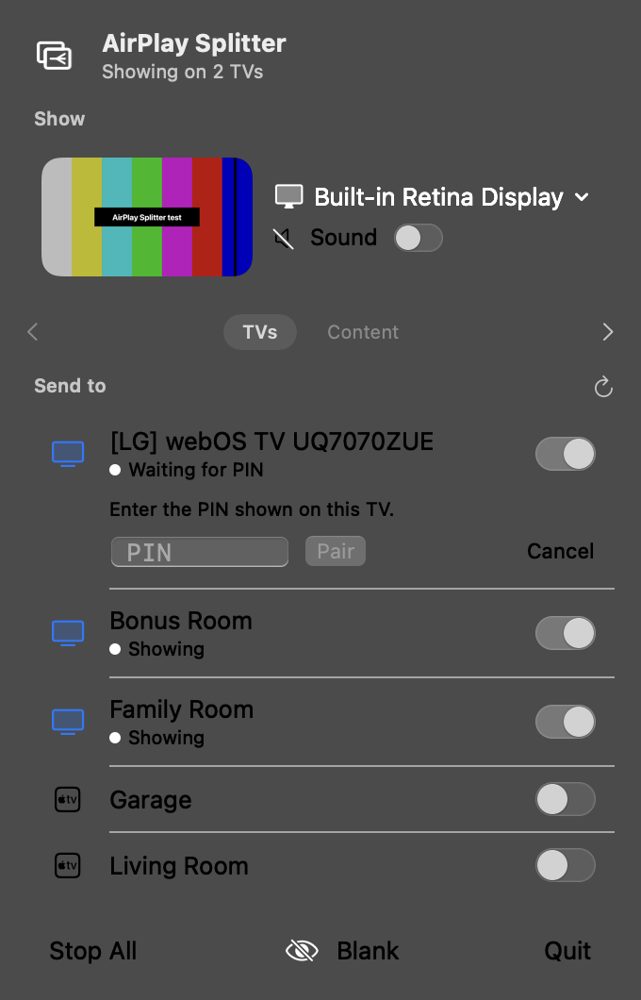
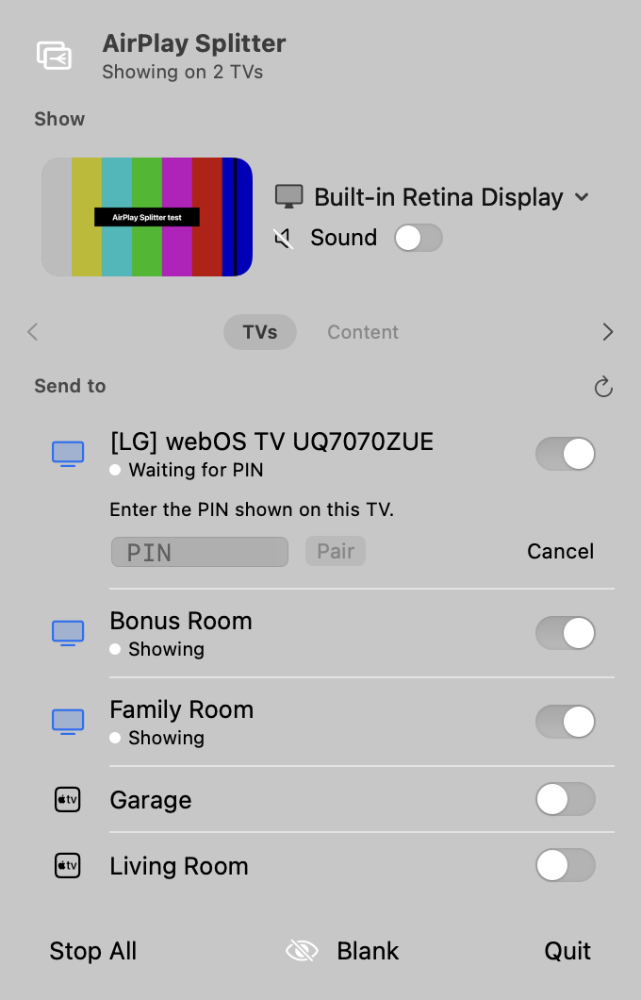
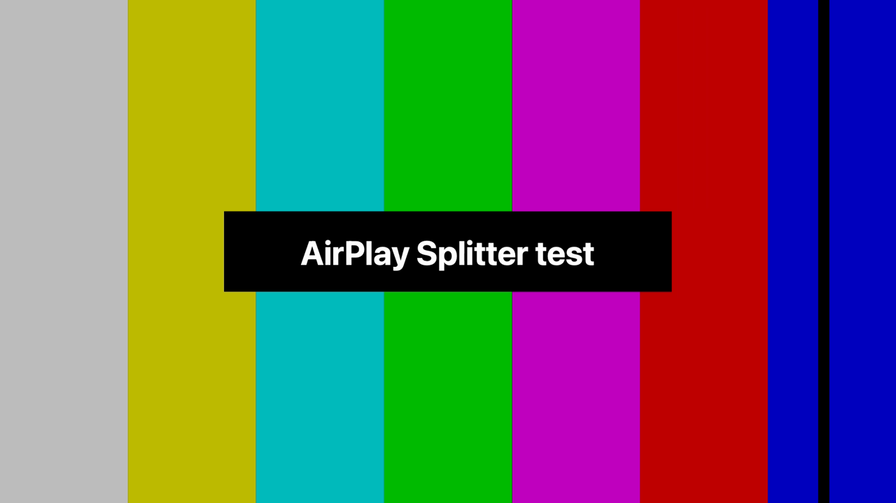

<p align="center"></p>

<h1 align="center">AirPlay Splitter</h1>

<p align="center"><b>One Mac. Every screen in the building.</b><br>
Send your screen, a window, or an iPhone to several AirPlay TVs at once, right from the menu bar.</p>

<p align="center">
  <a href="../../releases/latest"></a>
  
  
  
</p>

---

macOS mirrors to **one** AirPlay TV at a time. AirPlay Splitter sends the same picture, and sound if you want
it, to **as many as you like**: Apple TVs and AirPlay-capable Samsung, LG, Roku, Hisense and other smart TVs.

It was made for churches, schools and offices, where the sanctuary, lobby and classrooms all need the same
slides at the same moment. It's a tiny menu-bar utility, not a display manager: the fastest way to get
something onto every screen.

<p align="center">
  
  &nbsp;&nbsp;
  
</p>

## What it does

- **Switch TVs on.** Every AirPlay TV on your network is listed with its own switch. The first time, the TV
  shows a PIN; type it into the box that opens right under that TV. It's remembered after that.
- **Choose what to show.** A whole screen, **one window** (with Apple's own window picker), **an area you drag
  out**, an **iPhone or iPad**, or a **test pattern**.
- **Sound on or off.** One switch sends the Mac's audio to the TVs too. It's off by default so a room's own
  speakers don't double up.
- **See what's live.** A small preview shows exactly what the TVs are showing.
- **Built for big buildings.** Dozens of TVs scroll in a compact list, and the ones you've switched on stay at
  the top.
- **One encoder for every TV.** The picture is encoded once with the Mac's hardware encoder and shared, so
  adding a fourth TV costs almost nothing.
- **Nothing else to install.** Everything it needs is inside the app.
- **Stays up to date.** It checks GitHub once a day and offers a one-click download when a new version is out.

<p align="center">
  
  <br><sub>The built-in test pattern: check every TV before a service without sharing your screen.</sub>
</p>

## Install

1. Download **AirPlay-Splitter-x.y.z.dmg** from [the latest release](../../releases/latest).
2. Open it and drag **AirPlay Splitter** onto **Applications**.
3. The first time, **right-click** the app and choose **Open**. (The build isn't notarized yet, so macOS asks.)
4. Click the new icon in the menu bar. Allow **Local Network** so it can find your TVs.
5. To show your screen, click **Open Settings**, allow **Screen Recording** for AirPlay Splitter, then click
   **Relaunch**. Sharing a single window doesn't need this.

## Which Macs this is for

AirPlay Splitter is built for **Apple Silicon Macs (M1, M2, M3, M4, M5 and later)** running **macOS 14 or
later**. The download is an `arm64` build and is only tested there. It won't run on Intel Macs as shipped. On
macOS 26 the menu uses Liquid Glass.

**Ports are welcome.** Nothing in the design is tied to Apple Silicon. Every part already exists for other
processors, so a port is mostly build work:

| Target | What a port involves |
|---|---|
| **Intel Macs** | Everything used here runs on Intel too: Swift, ScreenCaptureKit, VideoToolbox, Go, UxPlay and Homebrew's GStreamer (in `/usr/local` instead of `/opt/homebrew`). Build each piece for `x86_64` (`swift build --arch x86_64`, `GOARCH=amd64`, UxPlay with CMake on Intel). The bundler script uses `brew --prefix`, so it already follows Homebrew's location. Joining both builds with `lipo` would give one universal app. |
| **Linux** | The sending engine, [doubletake](https://github.com/omarroth/doubletake), is a Linux program to begin with, and UxPlay runs there as well. The menu-bar app is Mac-only (SwiftUI and ScreenCaptureKit), so Linux would need its own small front end. doubletake already ships a KDE Plasma widget to start from. |
| **Windows** | UxPlay runs on Windows, and [open-airplay](https://github.com/parsakhaz/open-airplay) has ported doubletake's protocol code there. Like Linux, it would need its own front end. |

If you start a port, open an issue so others can find and help with it.

## How it works

```
Screen, window or area ─► ScreenCaptureKit ─┐
Mac sound ────────────────────────────────┤
                                          ├─► localhost ─► doubletake ─┬─► TV 1
iPhone or iPad ─► UxPlay ("AirPlay        │   (H.264 and   (decode once, ├─► TV 2
                  Splitter" receiver) ────┘    PCM audio)  encode once)  └─► TV 3 …
```

| Part | What it does |
|---|---|
| `app/` | SwiftUI menu-bar app. Captures the screen and sound, finds TVs with Bonjour, runs the tools below. |
| `vendor/doubletake-main/` | [doubletake](https://github.com/omarroth/doubletake), the AirPlay mirroring sender, ported to macOS. It pairs with each TV and fans one stream out to all of them. |
| `vendor/UxPlay/` | [UxPlay](https://github.com/FDH2/UxPlay) (submodule), an AirPlay receiver, so phones and iPads can mirror in. |
| `scripts/bundle_gstreamer.py` | Copies the GStreamer pieces the tools use into the app and relinks them, so it runs with nothing else installed. |

### Changes to doubletake

doubletake targets Linux. This copy adds, in a few hundred lines:
- `-relay-port` and `-relay-audio-port`: take video and audio from localhost instead of capturing the screen
  (`internal/airplay/relay_source.go`).
- VideoToolbox hardware encoding (`-hwaccel videotoolbox`), with SEI units dropped for strict receivers.
- A video-only fallback for TVs that only accept AAC-ELD audio, so they still connect.
- A non-Linux process attribute so it builds on macOS (`proc_attr_*.go`).

## Build from source

```bash
scripts/bootstrap.sh        # once: Homebrew packages, UxPlay submodule and build
app/build-app.sh            # build and install to ~/Applications
app/build-app.sh --dmg      # also write dist/AirPlay-Splitter-<version>.dmg
```

Homebrew is only needed to **build**. The finished app carries its own copy of everything.

Signing uses a *Developer ID Application* certificate if one is installed, otherwise ad-hoc. Set
`NOTARY_PROFILE` (from `xcrun notarytool store-credentials`) to notarize the DMG. To publish a release, add a
`## x.y.z · Month Day, Year` section to `CHANGELOG.md`, then run `scripts/release.sh x.y.z`.

See [ROADMAP.md](ROADMAP.md) for what's planned next.

## Troubleshooting

- **Black screen on the TVs:** Screen Recording isn't allowed yet, or the app wasn't relaunched after allowing
  it. Try *Test Pattern*: if that shows, the TVs and network are fine.
- **No TVs listed:** allow Local Network for AirPlay Splitter in System Settings › Privacy & Security.
- **A TV has picture but no sound:** some TVs only accept a kind of AirPlay audio (AAC-ELD) this build can't
  make yet, so they get video only.
- **Logs:** `~/Library/Application Support/AirPlaySplitter/`

## Thank you

AirPlay Splitter is a small app standing on a lot of generous work. Thank you to everyone below.

**The engines inside the app**
- **[doubletake](https://github.com/omarroth/doubletake)** by **Omar Roth**: the AirPlay mirroring sender that
  makes multi-TV streaming possible. LGPL-3.0-or-later. Its author notes much of it was written with LLMs, so
  test before relying on it for a live event.
- **[UxPlay](https://github.com/FDH2/UxPlay)** by **F. Duncanh** and contributors, building on
  **[RPiPlay](https://github.com/FD-/RPiPlay)** by **Florian Draschbacher** and the original UxPlay by
  **antimof**: the AirPlay receiver that lets phones mirror in. GPL-3.0.
- **[GStreamer](https://gstreamer.freedesktop.org)** and its plugin authors: the media pipelines.
  LGPL-2.1-or-later.
- **[FFmpeg](https://ffmpeg.org)** (with x264, x265, dav1d, libvpx, SVT-AV1, LAME, mpg123, Opus and libvmaf):
  decoding iPhone and iPad audio and video.
- **[GLib](https://gitlab.gnome.org/GNOME/glib)**, **[ORC](https://gitlab.freedesktop.org/gstreamer/orc)**,
  **PCRE2**, **libjpeg-turbo**, **XZ Utils**, **gettext**, **libX11/libxcb**: the libraries those depend on.
- **[libplist](https://github.com/libimobiledevice/libplist)**, **[OpenSSL](https://www.openssl.org)** and
  **[llhttp](https://github.com/nodejs/llhttp)**: used by UxPlay.

**The people who figured out AirPlay**
- The **[Unofficial AirPlay Specification](https://openairplay.github.io/airplay-spec/)** and
  **[openairplay](https://github.com/openairplay)** contributors, **Juho Vähä-Herttua** (shairplay), the
  **playfair** FairPlay research, and everyone who reverse-engineered AirPlay mirroring over the years.

**Projects studied while designing this**
- [open-airplay](https://github.com/parsakhaz/open-airplay) (Windows port of doubletake's protocol),
  [airplay2-receiver](https://github.com/openairplay/airplay2-receiver),
  [goplay2](https://github.com/openairplay/goplay2),
  [AirplayMirroringGo](https://github.com/openairplay/AirplayMirroringGo),
  [Deskreen](https://github.com/pavlobu/deskreen),
  [Cap](https://github.com/CapSoftware/Cap) (screen capture), and
  [DeskPad](https://github.com/Stengo/DeskPad).

**Apple** for ScreenCaptureKit, VideoToolbox and SwiftUI, and **Homebrew** for making the build easy.

AirPlay is a trademark of Apple Inc. This project isn't affiliated with or endorsed by Apple.

## License

GPL-3.0-or-later (see [LICENSE](LICENSE)), because the app includes UxPlay (GPL-3.0). Bundled components keep
their own licenses as listed above.
